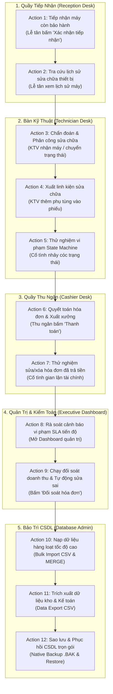

# 09. Kịch Bản Kiểm Thử & Trình Diễn Toàn Diện (Demo Scenarios & Action Mapping)

> **Dự án**: UIT CARE — Hệ Thống Quản Lý Tiếp Nhận & Bảo Hành Thiết Bị  
> **Hệ Quản Trị CSDL**: Microsoft SQL Server 2022 (Linux Docker Engine)  
> **Nguyên tắc thiết kế**: *Zero-Trust Data Integrity* — Toàn bộ quy tắc kho vận, phân loại bảo hành, máy trạng thái (State Machine) và khóa bất biến tài chính được thực thi trực tiếp tại Microsoft SQL Server Engine.  
> **Mục đích tài liệu**: Cung cấp tài liệu kịch bản trình diễn (Demo Walkthrough) chi tiết theo từng hành động của người dùng trên giao diện Web Next.js, bóc tách chính xác mọi **Stored Procedure, Trigger, Cursor, Function** được kích hoạt đồng thời ở tầng CSDL, kèm giải thích nghiệp vụ và snippet câu lệnh SQL thực tế.

---

## 🗺️ Toàn Cảnh 12 Kịch Bản Trình Diễn (12 Master Demo Actions)



---

## 🎯 Chi Tiết Từng Kịch Bản Demo (Action-Grouped Scenarios)

---

### 🟢 ACTION 1: Lễ Tân Tiếp Nhận Thiết Bị Mới Tại Quầy POS
- **Màn hình thực hiện**: Bàn tiếp nhận quầy POS (`/reception`)
- **Giải thích nghiệp vụ**:
  - Khi khách đem máy đến, lễ tân nhập SĐT khách và thông tin máy. Nếu máy có `is_under_warranty = 1` và ngày hết hạn vẫn còn trong tương lai, CSDL phải tự động nhận diện thiết bị này thuộc diện bảo hành chính hãng để miễn phí tiền công và phụ tùng sau này.
  - Đồng thời, CSDL phải ghi nhận ngay một dòng nhật ký (audit log) để đảm bảo tính minh bạch về thời gian và người tiếp nhận.
- **Thao tác người dùng (User Action)**:
  1. Lễ tân nhập SĐT khách hàng: `0901234501` (hệ thống tự fill tên: *Nguyen Van An*).
  2. Nhập thiết bị: *Dell XPS 15 9520*, Serial: *DELL-XPS-9901*, chọn ngày bảo hành là ngày mai hoặc tương lai.
  3. Chọn loại yêu cầu là `repair` (Sửa chữa thông thường), mô tả lỗi: *"Máy không lên nguồn"*.
  4. Bấm nút **[Xác nhận tiếp nhận & In biên nhận]**.

#### ⚙️ Các đối tượng CSDL được kích hoạt đồng thời:
1. **Stored Procedure**: `dbo.sp_receive_device` được gọi trực tiếp từ BE.
2. **Scalar UDF**: `dbo.fn_is_device_under_warranty(@device_id, GETDATE())` được gọi **ngầm bên trong procedure**.
   - *Logic CSDL*: CSDL tự động phát hiện thiết bị vẫn còn hạn bảo hành $\rightarrow$ **Tự động chuyển `ticket_type` từ `repair` sang `warranty`** mà không cần lễ tân phải can thiệp thủ công.
3. **DML Trigger**: `dbo.trg_tickets_audit_history` tự động kích hoạt trên sự kiện `AFTER INSERT` của bảng `tickets`.
   - *Logic CSDL*: Tự động chèn một dòng nhật ký vào bảng `ticket_status_history` ghi nhận: `status = 'received'`, `changed_by = receptionist_id`, mốc thời gian `GETDATE()`.

#### 💻 Snippet Code tương tác CSDL & Câu lệnh kiểm chứng:
```sql
-- Procedure được gọi từ Backend:
DECLARE @out_id INT;
EXEC dbo.sp_receive_device
    @device_id = 1,
    @receptionist_id = 1,
    @issue_description = N'Máy không lên nguồn',
    @initial_condition = N'Máy trầy nhẹ góc phải',
    @accessories = N'Sạc zin theo máy',
    @ticket_type = 'repair',
    @ticket_id = @out_id OUTPUT;
SELECT @out_id AS ticket_id;

-- Câu lệnh SQL kiểm chứng tại chỗ:
-- 1. Xem phiếu vừa tạo (được CSDL tự động set ticket_type = 'warranty'):
SELECT TOP 1 id, ticket_type, status, received_at FROM tickets ORDER BY id DESC;

-- 2. Xem lịch sử audit log được trigger sinh tự động:
SELECT * FROM ticket_status_history WHERE ticket_id = (SELECT TOP 1 id FROM tickets ORDER BY id DESC);
```

---

### 🟢 ACTION 2: Tra Cứu Lịch Sử Sửa Chữa Của Thiết Bị
- **Màn hình thực hiện**: Danh sách phiếu (`/tickets`) hoặc Cổng tra cứu công khai (`/tra-cuu`)
- **Giải thích nghiệp vụ**:
  - Một thiết bị có thể vào bảo hành/sửa chữa nhiều lần trong vòng đời. KTV hoặc khách hàng cần xem được toàn bộ lý lịch máy (đã từng thay linh kiện gì, lỗi do đâu, ai sửa) để chẩn đoán chính xác hơn hoặc kiểm tra xem máy có bị lỗi tái phát (`re_repair`) hay không.
- **Thao tác người dùng (User Action)**:
  - Lễ tân hoặc khách hàng nhập mã Serial thiết bị để tra cứu toàn bộ lịch sử các lần tiếp nhận trước đây.

#### ⚙️ Đối tượng CSDL được kích hoạt:
1. **Inline Table-Valued Function (TVF)**: `dbo.fn_get_device_repair_history(@device_id)`
   - *Logic CSDL*: Trả về bảng danh sách lịch sử sửa chữa kèm tên KTV phụ trách, nguyên nhân lỗi, giải pháp và thời điểm hoàn tất, sắp xếp giảm dần theo thời gian tiếp nhận.

#### 💻 Snippet Code tương tác CSDL:
```sql
-- Query Backend gọi xuống CSDL:
SELECT * FROM dbo.fn_get_device_repair_history(@device_id) ORDER BY received_at DESC;

-- Câu lệnh SQL kiểm chứng:
SELECT * FROM dbo.fn_get_device_repair_history(1);
```

---

### 🟢 ACTION 3: Kỹ Thuật Viên Tiếp Nhận Máy & Chẩn Đoán Lỗi
- **Màn hình thực hiện**: Bàn kỹ thuật (`/technician`) hoặc Modal Chi tiết phiếu
- **Giải thích nghiệp vụ**:
  - KTV nhận việc, chẩn đoán nguyên nhân kỹ thuật và giải pháp sửa chữa. Quá trình này phải được kiểm soát theo vòng đời máy trạng thái hợp lệ và ghi vết người thao tác.
- **Thao tác người dùng (User Action)**:
  1. KTV chọn phiếu trạng thái `received`, bấm nhận việc $\rightarrow$ Trạng thái chuyển sang `inspecting`.
  2. KTV kiểm tra máy, nhập nguyên nhân lỗi: *"Hỏng tụ nguồn bo mạch chính"*, phương án sửa: *"Thay thế cụm IC nguồn"*, dự toán chi phí: `450.000 VNĐ`.
  3. Bấm **[Cập nhật chẩn đoán & Chuyển đang sửa (repairing)]**.

#### ⚙️ Các đối tượng CSDL được kích hoạt:
1. **Stored Procedure**: `dbo.sp_process_ticket` thực thi với `@status = 'repairing'`, `@fault_cause`, `@repair_solution`.
2. **DML Trigger**: `dbo.trg_tickets_workflow_guard` kiểm tra điều kiện chuyển trạng thái hợp lệ (`received` $\rightarrow$ `inspecting` $\rightarrow$ `repairing`).
3. **DML Trigger**: `dbo.trg_tickets_audit_history` ghi nhận sự kiện chuyển trạng thái sang `repairing` và lưu ID KTV thực hiện vào audit log.

#### 💻 Snippet Code tương tác CSDL:
```sql
-- Procedure Backend thực thi:
EXEC dbo.sp_process_ticket
    @ticket_id = 1,
    @status = 'repairing',
    @technician_id = 3,
    @fault_cause = N'Hỏng tụ nguồn bo mạch chính',
    @repair_solution = N'Thay thế cụm IC nguồn',
    @estimated_cost = 450000;
```

---

### 🟢 ACTION 4: Kỹ Thuật Viên Xuất Linh Kiện Thay Thế Từ Kho
- **Màn hình thực hiện**: Modal kỹ thuật phiếu sửa chữa (`/technician`)
- **Giải thích nghiệp vụ**:
  - Khi thay thế linh kiện cho máy khách, hệ thống kho phải tự động trừ số lượng tồn kho theo thời gian thực (Real-time Inventory Deduction). Nếu kho không đủ hàng, CSDL phải từ chối xuất để tránh thất thoát hoặc âm kho.
- **Thao tác người dùng (User Action)**:
  1. Tại tab *Linh kiện & Chi phí*, KTV chọn linh kiện: `Pin laptop Dell 56Wh` (Part #2).
  2. Nhập số lượng: `1`.
  3. Bấm nút **[Thêm linh kiện vào phiếu]**.

#### ⚙️ Các đối tượng CSDL được kích hoạt đồng thời:
1. **Stored Procedure**: `dbo.sp_add_invoice_part` được gọi với `@invoice_id = 14`, `@part_id = 2`, `@quantity = 1` (nếu chưa có hóa đơn, hệ thống tự gọi `dbo.sp_create_invoice` trước).
   - Thủ tục kiểm tra tồn kho hiện tại và lấy đơn giá niêm yết chèn vào bảng `invoice_items`.
2. **DML Trigger**: `dbo.trg_invoice_items_stock` tự động kích hoạt trên `AFTER INSERT` của bảng `invoice_items`.
   - *Logic CSDL*: Tự động thực thi `UPDATE parts SET stock_quantity = stock_quantity - 1 WHERE id = 2`.
   - *Kiểm soát an toàn*: Nếu tồn kho không đủ, trigger sẽ ngay lập tức `ROLLBACK TRANSACTION` và ném mã lỗi `50001: Insufficient spare part inventory stock`.
3. **DML Trigger**: `dbo.trg_invoices_total_amount` tự động tính toán lại tổng tiền của hóa đơn `invoices`.

#### 💻 Snippet Code tương tác CSDL & Kiểm chứng:
```sql
-- Procedure Backend thực thi:
EXEC dbo.sp_add_invoice_part
    @invoice_id = 14,
    @part_id = 2,
    @quantity = 1;

-- Câu lệnh SQL kiểm chứng tồn kho đã tự động bị trừ đi 1:
SELECT id, part_name, stock_quantity FROM parts WHERE id = 2;
```

---

### 🔴 ACTION 5: Thử Nghiệm Tấn Công Gian Lận State Machine (Workflow Guard Demo)
- **Mục đích demo**: Chứng minh CSDL bảo vệ logic nghiệp vụ, chặn đứng hành vi nhảy cóc quy trình kể cả khi có người cố tình can thiệp qua API hoặc SQL.
- **Giải thích nghiệp vụ**:
  - Phiếu bảo hành phải tuân thủ nghiêm ngặt thứ tự: `received` $\rightarrow$ `inspecting` $\rightarrow$ `repairing` $\rightarrow$ `completed` $\rightarrow$ `delivered`. Tuyệt đối cấm vừa nhận máy đã giao luôn cho khách mà không qua kỹ thuật.
- **Thao tác người dùng (User Action)**:
  - Cố tình gửi lệnh cập nhật trạng thái phiếu từ `received` (Vừa nhận máy) nhảy cóc thẳng sang `delivered` (Đã giao máy cho khách).

#### ⚙️ Đối tượng CSDL kích hoạt & Chặn đứng:
1. **DML Trigger**: `dbo.trg_tickets_workflow_guard` trên bảng `tickets`.
   - *Kết quả*: Trigger phát hiện bước nhảy vi phạm ma trận vòng đời, thực thi lệnh `ROLLBACK` và ném lỗi:
     `50004: Invalid ticket status transition.`

#### 💻 Snippet Code kiểm chứng trực tiếp:
```sql
-- Cố tình vi phạm State Machine:
UPDATE tickets SET status = 'delivered' WHERE id = 1 AND status = 'received';

-- KẾT QUẢ TỪ SQL SERVER:
-- Msg 50004, Level 16, State 1, Trigger trg_tickets_workflow_guard
-- Invalid ticket status transition.
```

---

### 🟢 ACTION 6: Thu Ngân Quyết Toán Hóa Đơn & Thanh Toán Tại Quầy
- **Màn hình thực hiện**: Quầy thu ngân (`/cashier`)
- **Giải thích nghiệp vụ**:
  - Khi thiết bị đã sửa xong (`completed`), hóa đơn vẫn ở trạng thái `unpaid`. Thu ngân bấm thanh toán thủ công; CSDL chốt hóa đơn sang `paid` và chuyển phiếu sang `delivered`.
- **Thao tác người dùng (User Action)**:
  1. Thu ngân tìm phiếu đã sửa xong (`status = 'completed'`).
  2. Bấm nút **[Thanh toán]** $\rightarrow$ Modal thanh toán hiển thị.
  3. Nhập tiền công thợ (`labor_fee` = 150.000 VNĐ), chọn phương thức thanh toán: `bank_transfer`.
  4. Bấm nút **[Xác nhận thanh toán & Xuất hóa đơn]**.

#### ⚙️ Các đối tượng CSDL được kích hoạt đồng thời:
1. **Stored Procedure**: `dbo.sp_checkout_invoice` thực thi với `@invoice_id = 14`, `@payment_method = 'bank_transfer'`.
2. **Cập nhật hóa đơn & phiếu**: Chuyển trạng thái hóa đơn sang `paid`, gán ngày `paid_at = GETDATE()`, đồng thời chuyển phiếu sang `delivered`.
3. **DML Trigger**: `dbo.trg_tickets_audit_history` ghi nhận log phiếu chuyển sang `delivered`.

#### 💻 Snippet Code tương tác CSDL & Kiểm chứng:
```sql
-- Procedure Backend thực thi:
EXEC dbo.sp_checkout_invoice
    @invoice_id = 14,
    @payment_method = 'bank_transfer';

-- Kiểm chứng hóa đơn đã thanh toán:
SELECT id, status, payment_method, paid_at, total_amount FROM invoices WHERE id = 14;
SELECT id, status FROM tickets WHERE id = 15;
```

---

### 🔴 ACTION 7: Thử Nghiệm Gian Lận Sửa Số Tiền Hóa Đơn Đã Quyết Toán (Immutability Demo)
- **Mục đích demo**: Chứng minh cơ chế khóa tài chính bất biến (Financial Immutability) ngăn chặn gian lận kế toán hoặc xóa hóa đơn sau khi đã thu tiền.
- **Giải thích nghiệp vụ**:
  - Hóa đơn sau khi đã thanh toán (`paid_at IS NOT NULL`) là chứng từ tài chính pháp lý bất biến. Tuyệt đối cấm nhân viên sửa số tiền hoặc xóa dòng linh kiện để ăn chặn chênh lệch.
- **Thao tác người dùng (User Action)**:
  - Cố tình sửa giảm số tiền `total_amount` hoặc xóa hóa đơn sau khi đã thanh toán.

#### ⚙️ Các đối tượng CSDL kích hoạt & Chặn đứng:
1. **DML Trigger**: `dbo.trg_invoices_freeze_paid_amounts` trên bảng `invoices`.
   - *Kết quả*: Chặn lệnh UPDATE / DELETE, ném lỗi:
     `50036: Financial data of a paid invoice is immutable and cannot be altered or reversed.`
2. **DML Trigger**: `dbo.trg_invoice_items_freeze_paid` trên bảng `invoice_items`.
   - *Kết quả*: Chặn hành vi thêm bớt linh kiện vào hóa đơn đã chốt thu tiền:
     `50035: Cannot add, modify, or remove spare parts on an already paid invoice.`

#### 💻 Snippet Code kiểm chứng trực tiếp:
```sql
-- Cố tình sửa số tiền của hóa đơn đã thanh toán:
UPDATE invoices SET total_amount = 0 WHERE id = 1 AND paid_at IS NOT NULL;

-- KẾT QUẢ TỪ SQL SERVER:
-- Msg 50036, Level 16, State 1, Trigger trg_invoices_freeze_paid_amounts
-- Financial data of a paid invoice is immutable and cannot be altered or reversed.
```

---

### 🟢 ACTION 8: Giám Sát Cảnh Báo Vi Phạm Cam Kết Thời Gian (SLA Alerting)
- **Màn hình thực hiện**: Executive Dashboard (`/dashboard`)
- **Giải thích nghiệp vụ**:
  - Ban Quản lý cần theo dõi các máy bị "ngâm" quá lâu tại trung tâm (vượt quá 14 ngày) để đôn đốc KTV, tránh bị khách hàng khiếu nại làm giảm uy tín trung tâm.
- **Thao tác người dùng (User Action)**:
  - Giám đốc / Trưởng phòng kỹ thuật mở trang Tổng quan Dashboard.

#### ⚙️ Các đối tượng CSDL được kích hoạt:
1. **Cursor T-SQL**: `cur_delayed_tickets` bên trong thủ tục `dbo.sp_alert_delayed_tickets @delay_days = 14`.
   - *Cơ chế Cursor*: Con trỏ `LOCAL FAST_FORWARD` duyệt qua từng phiếu quá hạn 14 ngày chưa sửa xong, trích xuất họ tên khách hàng, số điện thoại, tên thiết bị, tên kỹ thuật viên phụ trách và tính số ngày chậm trễ (`overdue_days`).
   - Dữ liệu được nạp vào bảng tạm và render thành **khối Widget thẻ đỏ cảnh báo vi phạm SLA** trên giao diện.

#### 💻 Snippet Code tương tác CSDL:
```sql
-- Procedure Backend thực thi khi Quản lý mở Dashboard:
EXEC dbo.sp_alert_delayed_tickets @delay_days = 14;

-- Trả về bảng kết quả:
-- ticket_id | customer_name | phone_number | device_name | status | overdue_days | assigned_technician
```

---

### 🟢 ACTION 9: Kiểm Toán Đối Soát Doanh Thu Tự Động & Sửa Sai Lệch (Financial Auditing)
- **Màn hình thực hiện**: Executive Dashboard (`/dashboard`)
- **Giải thích nghiệp vụ**:
  - Trong thực tế, có thể có rủi ro đồng bộ dữ liệu hoặc can thiệp bất thường dẫn đến việc `total_amount` trong hóa đơn không khớp với tổng tiền linh kiện + công thợ - giảm giá. Thủ tục đối soát sử dụng Cursor sẽ quét toàn bộ hóa đơn, phát hiện sai lệch và tự động sửa sai.
- **Thao tác người dùng (User Action)**:
  1. Quản lý bấm nút **[Đối soát hóa đơn]** trên thanh công cụ Dashboard.
  2. Tích chọn checkbox: *"Tự động hiệu chỉnh nếu phát hiện sai lệch"* (`autoFix = true`).
  3. Bấm **[Bắt đầu đối soát]**.

#### ⚙️ Các đối tượng CSDL được kích hoạt:
1. **Stored Procedure**: `dbo.sp_audit_invoices @auto_fix = 1`.
2. **Cursor T-SQL**: `cur_invoices` duyệt tuần tự qua từng hóa đơn trong CSDL:
   - Tại mỗi dòng, gọi hàm **Scalar UDF**: `dbo.fn_calculate_parts_total(@inv_id)`.
   - Tính tổng chuẩn: $\text{chuẩn} = \text{tiền công} + \text{tiền linh kiện} - \text{tiền giảm giá}$.
   - So sánh với `total_amount` đã lưu. Nếu phát hiện lệch, Cursor đếm số lượng lỗi và tự động chạy lệnh `UPDATE invoices` sửa lại số tiền chính xác.
3. Dashboard hiển thị thông báo Toast: *"Đối soát hoàn tất. Đã tự động hiệu chỉnh thành công!"*.

#### 💻 Snippet Code tương tác CSDL:
```sql
-- Procedure Backend thực thi:
EXEC dbo.sp_audit_invoices @auto_fix = 1;

-- Kết quả trả về:
-- discrepancies_found | was_auto_fixed
-- --------------------+---------------
-- 0                   | 1
```

---

### 🟢 ACTION 10: Nhập Liệu Hàng Loạt Tốc Độ Cao (Bulk Import & MERGE)
- **Màn hình thực hiện**: Kho linh kiện (`/inventory`) hoặc Quản trị CSDL (`/database`)
- **Giải thích nghiệp vụ**:
  - Nhập danh mục 1.000 linh kiện từ nhà cung cấp qua file CSV. Nếu dùng từng lệnh INSERT tuần tự ở tầng ứng dụng sẽ mất vài chục giây và dễ lỗi kết nối.
  - CSDL giải quyết bài toán này bằng **T-SQL Native `BULK INSERT`** vào bảng tạm Staging, kết hợp câu lệnh **`MERGE`** để: nếu linh kiện đã có thì cộng dồn số lượng tồn và cập nhật giá mới; nếu chưa có thì chèn mới.
- **Thao tác người dùng (User Action)**:
  1. Quản lý bấm nút **[Nhập hàng loạt CSV]** tại màn hình Kho linh kiện hoặc Danh sách phiếu.
  2. Chọn file `parts_sample.csv` (chứa hàng trăm dòng linh kiện).
  3. Bấm **[Tải lên & Xử lý]**.

#### ⚙️ Các đối tượng CSDL được kích hoạt:
1. **Stored Procedure**: `dbo.sp_bulk_import_parts @csv_file_path = N'/tmp/parts_upload.csv'`.
   - Khởi tạo bảng tạm `#staging_parts`.
   - Nạp toàn bộ file bằng lệnh `BULK INSERT #staging_parts ... WITH (FORMAT = 'CSV', FIRSTROW = 2)`.
   - Chạy lệnh `MERGE dbo.parts AS target USING (...) ON target.part_name = source.part_name` để thực hiện Upsert (Cập nhật hoặc Chèn mới) trong 1 transaction nguyên tử.
2. Tương tự với phiếu bảo hành: gọi `dbo.sp_bulk_import_tickets` nạp đồng loạt hàng chục phiếu vào hệ thống.

#### 💻 Snippet Code tương tác CSDL:
```sql
-- Procedure Backend thực thi:
DECLARE @rows INT;
EXEC dbo.sp_bulk_import_parts 
    @csv_file_path = N'/var/opt/mssql/backup/parts_import.csv', 
    @rows_imported = @rows OUTPUT;
SELECT @rows AS rows_affected;
```

---

### 🟢 ACTION 11: Trích Xuất Dữ Liệu An Toàn & Sổ Cái Kế Toán (Data Export)
- **Màn hình thực hiện**: Kho linh kiện (`/inventory`), Danh sách hóa đơn (`/invoices`), hoặc Quản trị CSDL (`/database`)
- **Giải thích nghiệp vụ**:
  - Phục vụ công tác kiểm kê định kỳ và đối soát tài chính của kế toán. Dữ liệu xuất ra phải được chuẩn hóa thời gian quốc tế `yyyy-MM-dd HH:mm:ss` để tránh lỗi định dạng ngày tháng trên Excel, và tuyệt đối che giấu các trường nhạy cảm (như `password_hash`).
- **Thao tác người dùng (User Action)**:
  - Người dùng bấm nút **[Xuất CSV]** tại màn hình Hóa đơn hoặc Kho linh kiện để tải file về máy.

#### ⚙️ Các đối tượng CSDL được kích hoạt:
1. **`dbo.sp_export_parts_data`**: Trích xuất toàn bộ danh mục linh kiện, đơn giá, số lượng tồn kho định dạng sẵn.
2. **`dbo.sp_export_invoices_data`**: Trích xuất sổ cái kế toán hóa đơn, ngày thanh toán, tiền công và phương thức trả.
3. Backend nạp kết quả và stream trực tiếp về client dưới định dạng file CSV (`RFC 4180`).

#### 💻 Snippet Code tương tác CSDL:
```sql
-- Backend gọi thủ tục xuất dữ liệu:
EXEC dbo.sp_export_parts_data;
EXEC dbo.sp_export_invoices_data;
```

---

### 🟢 ACTION 12: Sao Lưu & Phục Hồi CSDL Trọn Gói (Native Backup & Restore)
- **Màn hình thực hiện**: Quản trị CSDL (`/database`)
- **Giải thích nghiệp vụ thực tế vs Trực quan hóa đồ án**:
  - *Trong môi trường Production thực tế*: Quản trị viên hệ thống (DBA) thường lập lịch sao lưu tự động qua **SQL Server Agent Jobs** hoặc **Cron Job** vào lúc nửa đêm (2h - 4h sáng) khi lượng truy cập của người dùng ở mức thấp nhất, kết hợp mô hình: Full Backup hàng tuần + Differential Backup hàng ngày + Transaction Log Backup mỗi 15 phút.
  - *Trong đồ án & Trình diễn trực quan*: Để hội đồng và người dùng có thể **chủ động kiểm thử và quan sát trực tiếp kết quả ngay lập tức**, hệ thống đã đóng gói quy trình này thành **Stored Procedure chuyên biệt** (`sp_backup_database` & `sp_restore_database`) kết nối trực tiếp với giao diện Web UI Next.js:
    - Quản lý có thể bấm nút tạo file backup `.BAK` vật lý trên server bất cứ lúc nào.
    - Danh sách các file backup hiển thị trực quan kèm dung lượng và thời gian tạo.
    - Hỗ trợ tải file `.BAK` về máy cá nhân hoặc chọn 1 bản sao lưu trong quá khứ để Phục hồi (Restore) toàn bộ CSDL chỉ bằng 1 cú click chuột.
- **Thao tác người dùng (User Action)**:
  1. Quản lý bấm nút **[Tạo bản sao lưu ngay (.BAK)]**.
  2. Bấm nút **Tải về (.BAK)** của một bản sao lưu.
  3. Chọn một bản backup và bấm nút **[Phục hồi CSDL (Restore)]**.

#### ⚙️ Các đối tượng CSDL được kích hoạt:
1. **`dbo.sp_backup_database`**:
   - Tự động sinh tên file theo định dạng: `warranty_management_backup_yyyyMMdd_HHmmss.bak`.
   - Thực thi lệnh native: `BACKUP DATABASE warranty_management TO DISK = @path WITH FORMAT, INIT, COMPRESSION;`.
2. **`master.dbo.sp_restore_database`**:
   - Chạy trên context CSDL `master`.
   - Đưa CSDL về chế độ độc quyền: `ALTER DATABASE warranty_management SET SINGLE_USER WITH ROLLBACK IMMEDIATE;` để ngắt toàn bộ connection đang mở từ API.
   - Chạy lệnh khôi phục: `RESTORE DATABASE warranty_management FROM DISK = @path WITH REPLACE;`.
   - Đưa CSDL trở lại chế độ bình thường: `ALTER DATABASE warranty_management SET MULTI_USER;`.

#### 💻 Snippet Code tương tác CSDL & Kiểm chứng:
```sql
-- 1. Thủ tục Sao lưu:
EXEC dbo.sp_backup_database;

-- 2. Thủ tục Phục hồi an toàn (chạy trong master context):
USE master;
EXEC master.dbo.sp_restore_database @backup_path = N'/var/opt/mssql/backup/warranty_management_backup_20261011_004500.bak';
USE warranty_management;
```

---

## 📊 Bảng Ma Trận Kích Hoạt Toàn Diện (Full Traceability Matrix)

| Demo Action | Thao tác trên Web UI | Stored Procedure | DML Trigger | Cursor T-SQL | Function (UDF) |
| :---: | :--- | :--- | :--- | :--- | :--- |
| **Action 1** | Lễ tân tiếp nhận máy (`/reception`) | `sp_receive_device` | `trg_tickets_audit_history` | — | `fn_is_device_under_warranty` |
| **Action 2** | Tra cứu lý lịch máy (`/tra-cuu`) | — | — | — | `fn_get_device_repair_history` |
| **Action 3** | KTV chẩn đoán & chuyển trạng thái (`/technician`) | `sp_process_ticket` | `trg_tickets_workflow_guard`<br/>`trg_tickets_audit_history` | — | — |
| **Action 4** | KTV xuất kho linh kiện (`/technician`) | `sp_add_invoice_part` | `trg_invoice_items_stock`<br/>`trg_invoices_total_amount` | — | — |
| **Action 5** | Test chặn gian lận State Machine | `sp_process_ticket` | `trg_tickets_workflow_guard` *(CHẶN)* | — | — |
| **Action 6** | Thu ngân thanh toán hóa đơn (`/cashier`) | `sp_checkout_invoice` | `trg_tickets_audit_history` | — | `fn_calculate_parts_total` |
| **Action 7** | Test chặn gian lận hóa đơn đã thanh toán | Lệnh UPDATE / DELETE | `trg_invoices_freeze_paid_amounts`<br/>`trg_invoice_items_freeze_paid` *(CHẶN)* | — | — |
| **Action 8** | Xem cảnh báo trễ hạn SLA (`/dashboard`) | `sp_alert_delayed_tickets` | — | `cur_delayed_tickets` | — |
| **Action 9** | Đối soát hóa đơn tự động (`/dashboard`) | `sp_audit_invoices` | — | `cur_invoices` | `fn_calculate_parts_total` |
| **Action 10** | Nhập liệu hàng loạt CSV (`/inventory`, `/tickets`) | `sp_bulk_import_parts`<br/>`sp_bulk_import_tickets` | — | — | — |
| **Action 11** | Xuất dữ liệu kho & Kế toán (`/inventory`, `/invoices`) | `sp_export_parts_data`<br/>`sp_export_invoices_data` | — | — | — |
| **Action 12** | Sao lưu & Phục hồi CSDL (`/database`) | `sp_backup_database`<br/>`sp_restore_database` | — | — | — |

---

> 💡 **Kinh Nghiệm Thuyết Trình Bảo Vệ (Defending Tip)**:  
> Khi hội đồng đặt câu hỏi: *"Các ràng buộc và trigger này có thực sự chạy không hay chỉ code giao diện?"*  
> $\rightarrow$ Người trình bày mở song song 2 cửa sổ:  
> - **Cửa sổ 1**: Web Next.js bấm thao tác (ví dụ Action 5 cố tình nhảy cóc trạng thái hoặc Action 7 cố tình sửa tiền hóa đơn đã thanh toán).  
> - **Cửa sổ 2**: DBeaver / terminal hiển thị mã lỗi đỏ do SQL Server trả về (`50004` hoặc `50050`), chứng minh **CSDL là bức tường bảo vệ tầng chót (Zero-Trust)** không thể bị qua mặt!
